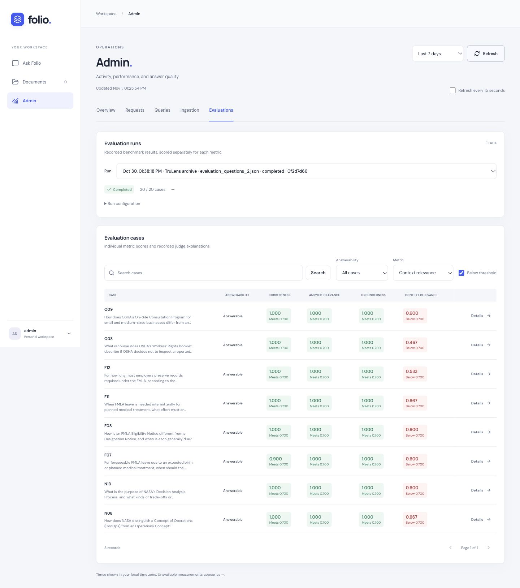
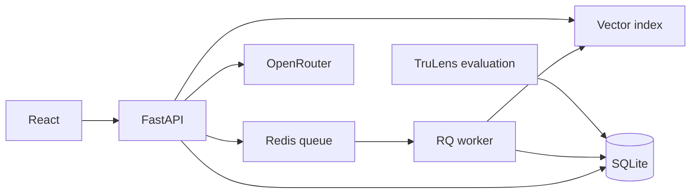

# Folio

Upload PDFs, ask questions, and inspect the passages behind each answer.
Documents and search results are scoped to the signed-in user.

Built with React, TypeScript, FastAPI, LlamaIndex, Redis/RQ, SQLite, and TruLens.



## How it works

PDF uploads are checked for duplicate content and sent to an RQ worker for
parsing, sentence-window indexing, and embedding. Queries retrieve 20 candidates,
rerank them, and pass the selected sentence windows to OpenRouter for an answer
with sources. The final result count is configurable from 1 to 20.



- Document ownership is applied before retrieval and reranking.
- The API caches model weights and the index; index changes trigger a reload.
- The admin panel shows request logs, latency, ingestion status, and evaluation
  scores. Token usage and cost appear when reported by the provider.

## Evaluation

A historical TruLens snapshot covers 20 development questions across NASA, FMLA,
and OSHA documents, including partial and unanswerable questions.

| Metric | Mean score | Cases scored |
| --- | ---: | ---: |
| Correctness | 0.980 | 20 |
| Answer relevance | 0.983 | 20 |
| Groundedness | 1.000 | 20 |
| Context relevance | 0.704 | 18 |

Context relevance excludes the partial and unanswerable cases. These are
LLM-judged development scores; historical model settings were not recorded.
The [evaluation report](evals/RESULTS.md) includes the limitations, individual
answers, judge explanations, and [JSON](evals/results/2026-10-30-archive.json)
and [CSV](evals/results/2026-10-30-archive.csv) results.

To run a new evaluation, upload the benchmark PDFs to an account, get its ID from
`GET /auth/me`, and run:

```sh
uv run python -m src.evaluate --owner-id YOUR_USER_ID
```

This uses OpenRouter credits. Results appear in the admin panel.

## Run locally

Requires Python 3.14, uv, Node.js 22.12+ with npm, and Redis.

```sh
uv sync
npm --prefix frontend ci
```

Create `.env` from [.env.example](.env.example) and set `OPENROUTER_API_KEY`.
Redis defaults to `redis://localhost:6379/0`.

With Redis running, start each command in a separate terminal:

```sh
uv run uvicorn src.api:app --reload
```

```sh
uv run python -m src.worker
```

```sh
npm --prefix frontend run dev
```

Open [localhost:5173](http://localhost:5173), create an account, and upload a PDF
(up to 10 MB). Sample documents are in [data/](data/).
Models download on first use, so the first ingestion and query take longer.
[API docs](http://127.0.0.1:8000/docs) are available while the backend is running.

### Admin access

Create a local administrator, then sign in through the app:

```sh
uv run python -m src.manage_admin create admin
```

The command prompts for a password. To promote an existing account, use
`uv run python -m src.manage_admin grant YOUR_EMAIL`.

### Google and GitHub sign-in

Email/password sign-in works without OAuth configuration. To enable a provider,
set its client ID and secret in `.env` and register the matching callback:

| Provider | Local callback |
| --- | --- |
| Google | `http://localhost:5173/api/auth/oauth/google/callback` |
| GitHub | `http://localhost:5173/api/auth/oauth/github/callback` |

Restart the API after setting credentials. For another origin, update `APP_URL`
and the registered callbacks.

The app currently uses a shared filesystem index and SQLite for a single-host
setup. Account recovery and automatic retries for failed ingestions are not
implemented.
