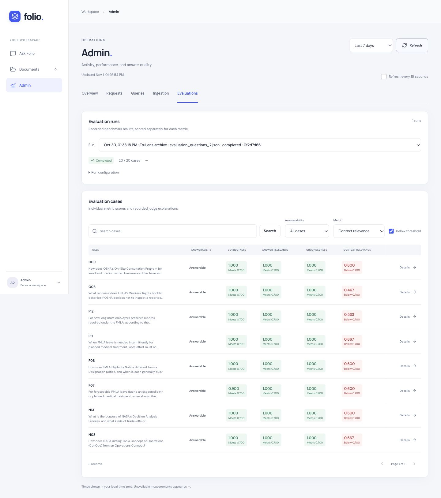

# Evaluation evidence

Folio was evaluated on a **20-question development set** covering NASA systems
engineering, FMLA employer guidance, and OSHA workers' rights documents. These are
LLM-judged answer-quality scores from an imported TruLens archive dated
**October 30, 2026**. They describe the archived answers, not a fresh evaluation
of the current code or a general accuracy estimate.

## Results

| Metric | Mean score | Scored | Skipped | Below 0.70 |
| --- | ---: | ---: | ---: | ---: |
| Correctness | 0.980 | 20 | 0 | 0 |
| Answer relevance | 0.983 | 20 | 0 | 1 |
| Groundedness | 1.000 | 20 | 0 | 0 |
| Context relevance | 0.704 | 18 | 2 | 8 |

Scores range from 0 to 1. Each mean is the unweighted arithmetic mean of the
available case-level scores for that metric. No metric errors or unavailable
scores were present in this export. Skipped scores are excluded, never replaced
with zero. Context relevance excludes one partial and one unanswerable case.
The **0.70 display threshold was chosen during archive import**, rather than
calibrated against human judgments. Metrics remain separate; there is no overall
pass/fail result. A groundedness mean of 1.000 reflects the judge's scores on
these answers, not proof that the system cannot hallucinate.

[Per-case JSON, answers and judge reasons](results/2026-10-30-archive.json) ·
[CSV score table](results/2026-10-30-archive.csv) ·
[Question set](evaluation_questions_2.json)

## Dataset

| Answerability | Cases |
| --- | ---: |
| Fully answerable | 18 |
| Partial | 1 |
| Unanswerable | 1 |

The source labels comprise 7 NASA cases, 7 FMLA cases, 4 OSHA cases, and 2
cross-document/synthetic cases. Questions exercise definitions, distinctions,
procedures and evidence gaps. The partial and unanswerable cases include
invented company-specific details that the documents do not establish.
This dataset was used during development; it is not an independent held-out set.

The current dataset file has SHA-256:

`05ff8de71946768d3844236daf1f56944eab0daf96ccb3b6badf11d2690696ee`

All exported case IDs, question text, reference answers and answerability labels
match this file. Required facts and source hints in the JSON are copied from the
current file for interpretation. Historical file hashes were not captured.

The repository currently contains these source PDFs:

| Current source file | SHA-256 at export |
| --- | --- |
| [nasa_systems_engineering_handbook_0.pdf](../data/nasa_systems_engineering_handbook_0.pdf) | `8eeb4887a4dc57a23049da7dd2ed556833cf98e214b240468d987873164ff688` |
| [employerguide.pdf](../data/employerguide.pdf) | `66a4907a289999e0977d9e5f0f5afecdf14d1c65c31c6d8d347d35e9644a24b2` |
| [OSHA3021.pdf](../data/OSHA3021.pdf) | `2dcf310d9d1184635956719630487844e568000965227072eea6b46444f60dea` |

These hashes identify the current files; the archive does not prove that these
exact PDF bytes were used historically. The JSON contains benchmark answers and
judge reasons, but not the original retrieved chunks or page references.

## What the scores reveal

- **O08 — context selection:** context relevance is 0.467, while correctness,
  answer relevance and groundedness are each 1.000. The judge's explanations
  describe returned context about complaints and inspections that does not
  directly address the requested review/recourse procedure. This suggests
  unnecessary context despite enough evidence for a supported answer.
- **A02 — judge calibration:** answer relevance is 0.667, while correctness and
  groundedness are each 1.000. The answer explains the supported NASA concept
  and explicitly declines to invent a company-specific threshold. The relevance
  judge penalizes the unanswered company-specific part. This is a concrete
  reason to inspect metrics separately and review abstention scoring.
- **F07 — completeness:** correctness is 0.900. The judge notes that the answer
  covers notice timing but omits the reference's detail about employer notice
  procedures. This illustrates a completeness issue that remains hidden in a
  rounded headline average.

These are interpretations of the saved judge explanations, not independently
verified legal or engineering advice. All 20 cases are included below and in the
machine-readable snapshot, including every below-threshold score.

## Per-case scores

| Case | Answerability | Correctness | Answer relevance | Groundedness | Context relevance |
| --- | --- | ---: | ---: | ---: | ---: |
| A02 | partial | 1.000 | 0.667 | 1.000 | Skipped |
| A03 | unanswerable | 1.000 | 1.000 | 1.000 | Skipped |
| F07 | answerable | 0.900 | 1.000 | 1.000 | 0.600 |
| F08 | answerable | 1.000 | 1.000 | 1.000 | 0.600 |
| F09 | answerable | 1.000 | 1.000 | 1.000 | 0.733 |
| F10 | answerable | 0.800 | 1.000 | 1.000 | 0.733 |
| F11 | answerable | 1.000 | 1.000 | 1.000 | 0.667 |
| F12 | answerable | 1.000 | 1.000 | 1.000 | 0.533 |
| F13 | answerable | 1.000 | 1.000 | 1.000 | 0.733 |
| N08 | answerable | 1.000 | 1.000 | 1.000 | 0.667 |
| N09 | answerable | 1.000 | 1.000 | 1.000 | 1.000 |
| N10 | answerable | 1.000 | 1.000 | 1.000 | 0.800 |
| N11 | answerable | 1.000 | 1.000 | 1.000 | 0.733 |
| N12 | answerable | 1.000 | 1.000 | 1.000 | 0.733 |
| N13 | answerable | 1.000 | 1.000 | 1.000 | 0.600 |
| N14 | answerable | 0.900 | 1.000 | 1.000 | 0.733 |
| O06 | answerable | 1.000 | 1.000 | 1.000 | 0.933 |
| O07 | answerable | 1.000 | 1.000 | 1.000 | 0.800 |
| O08 | answerable | 1.000 | 1.000 | 1.000 | 0.467 |
| O09 | answerable | 1.000 | 1.000 | 1.000 | 0.600 |

## Run provenance and limitations

| Setting | Historical evidence |
| --- | --- |
| Archive date | October 30, 2026 |
| Export date | November 1, 2026 |
| Evaluator framework | TruLens |
| Generation model | Not recorded |
| Judge model | Not recorded |
| Embedding/reranker models | Not recorded |
| Chunk/window configuration | Not recorded |
| Retrieval count / requested final top-k | Not recorded |
| Generation temperature / maximum tokens | Not recorded |
| Original Git revision / package versions | Not recorded |
| Source count | 5 for each recorded query |
| Full evaluation duration | Not recorded |
| Threshold | 0.70 selected during archive import |

The importer takes the latest matching record per question. Its saved timestamp
is the latest selected query start, not a measured full-run start time. This
snapshot therefore does not establish one immutable historical code revision.
Current pipeline defaults have deliberately not been substituted for missing
historical settings.

This single development snapshot does not establish judge reliability,
held-out performance, repeated-run variability, or a measured improvement over
a baseline. LLM judgments can be inconsistent, as case A02 demonstrates.

## Timing scope

The CSV and JSON preserve each historical
`RetrieverQueryEngine.query` span in milliseconds. Those spans exclude engine
construction, HTTP handling and judge evaluation. They are not end-to-end API
latencies. The later cache-setup microbenchmark is separate and is not included
in these quality results.

## Reproduce a new evaluation

The archived answers and scores can be inspected, and the summary means
recomputed from the JSON, without API keys or access to the private SQLite
database. Exact historical regeneration is
not possible because model, code and environment provenance is missing.

For a new, fully identified run using the current code:

1. Follow the [local setup instructions](../README.md#run-locally), start Redis,
   the ingestion worker, and the API.
2. Register a regular account and upload the three PDFs above. Wait until all
   three are ready. Retrieval is scoped to that account; another account's PDFs
   are not used.
3. Obtain that account's user ID from `GET /auth/me` using its authenticated
   session or Bearer token.
4. Record the Git revision, Python/package environment, source-file hashes and
   current settings in [query_engine.py](../src/query_engine.py) and
   [ingest.py](../src/ingest.py). The current runner stores model names and
   requested top-k, but does not automatically record every provenance field.
5. Run the evaluator explicitly. This step calls OpenRouter for generation and
   judging and consumes credits:

```sh
uv run python -m src.evaluate \
  --owner-id YOUR_USER_ID \
  --questions evals/evaluation_questions_2.json \
  --top-k 5 \
  --judge-model openrouter/openai/gpt-4.1-mini \
  --threshold 0.7
```

Results are persisted case by case in application SQLite and can be inspected
under Admin → Evaluations. Compare runs only when dataset, corpus and metric
settings match. This publication did not run that command, regenerate answers,
or incur model costs. The historical database was opened read-only for export.

## Dashboard evidence



The screenshot is filtered to **context relevance below 0.70**, showing all eight
matching cases from the 20-case archive. Green and red indicators apply to each
metric independently. It shows the demonstration admin label and a shortened
benchmark run identifier. The full dataset is retained in the table and exports
above. Operational request logs, account IDs, credentials and local file paths
are not included in the published JSON or CSV.
